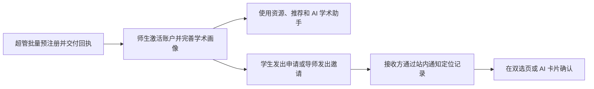
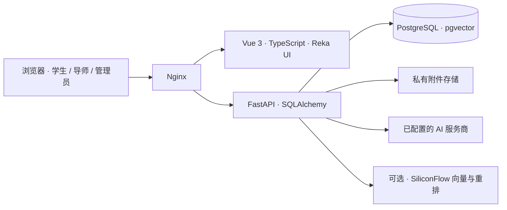

<p align="center">
  
</p>

<h1 align="center">智导未来 · AcademicNexus</h1>
<p align="center"><strong>面向合作院校的学术发展、导师双向选择和 AI 学习支持平台</strong><br />
Academic development, mutual mentor selection, and AI learning support for partner universities.</p>

<p align="center">
  <a href="VERSION"></a>
  <a href="#技术架构"></a>
  <a href="#技术架构"></a>
  <a href="#本地启动"></a>
</p>

<p align="center">
  <a href="#核心能力">核心能力</a> · <a href="#使用流程">使用流程</a> · <a href="#本地启动">本地启动</a> · <a href="#项目演进与更新日志">更新日志</a> · <a href="#测试与验证">测试与验证</a> · <a href="#项目团队">项目团队</a> · <a href="#english">English</a>
</p>

智导未来把学术画像、师生匹配、双选办理和学习资源放在同一个院校工作台。学生可以发现导师、了解研究方向并发起申请；导师可以查找学生、发出邀请和管理名额；学校可以组织账户激活、资源配额和订阅交付。AI 助手参与学术规划与沟通起草，关键操作由用户确认。

**当前版本为 Beta V1.0。** 项目从院校账户和学术画像起步，逐步加入师生互动、教学资源、院校订阅和语义推荐。本版完善了从发现对象到确认双选的完整流程，并统一账号隐私、站内通知和院校管理规则。各阶段的变化见[项目演进与更新日志](#项目演进与更新日志)。

## 核心能力

| 功能 | 产品能力 |
| --- | --- |
| **学术画像与匹配** | 分别维护师生的研究方向、兴趣、技能与经历。同校候选支持关键词搜索、学院筛选、排序和分页，可配置语义召回与重排。 |
| **导师双向选择** | 学生申请、导师邀请及双方确认。管理员可查看待处理和已确认记录，管理名额、个人例外规则及导师确认方式。状态变更接入站内通知。 |
| **学习资源** | 导师发布课程、论文、书籍及附件，学生查找同校资源。支持标签推荐、链接和文件交付、下载权限及导师存储配额。 |
| **AI 学术助手** | 支持 DeepSeek、MiniMax、OpenAI 与通义千问，用户可选择部署中已启用的服务商。提供多轮会话、实时流式回复、模型档位、邮件／短信／微信消息起草和双选办理卡片。 |
| **账户、联系与隐私** | 超级管理员通过 Excel 预注册和补发激活回执。学生与导师可按渠道公开或隐藏联系方式。邮件由本机客户端打开，师生联系人和交流入口受同校限制。 |
| **院校订阅与通知** | Basic、Pro、Ultra、Max 四档权益。管理端支持院校库存、Key 签发回收、Excel／PDF 交付、统计与历史。超级管理员可发送定向提醒；院校管理员可在授权范围内接收并办理。 |

### 学术匹配如何进入实际办理

1. **学术画像。** 学生维护研究兴趣、技能、学业情况、发展目标与经历。导师维护研究方向、代表成果、项目及指导方式。
2. **发现候选。** 服务端先限定学校、角色和有效账户，再计算相关性。页面支持关键词检索、学院筛选及分页，用户可从候选详情了解匹配依据。
3. **提出意向。** 学生发出申请或导师发出邀请。列表显示待处理、确认及已结束状态。学校可管理默认额度和个体例外。
4. **完成确认。** 接收人可从消息进入相应记录，也可在 AI 双选顾问中使用与当前状态相符的办理卡片。点击时，服务端重新核对双方权限、双选窗口、状态和名额。
5. **跟踪结果。** 申请、邀请、确认、撤回和管理端释放等业务变动触发站内通知。通知支持未读状态、历史查询和业务跳转。

### AI 助手与学术工作

| 场景 | 典型操作 |
| --- | --- |
| 学术规划 | 整理阶段目标、学习路线与科研准备事项，保存对话供后续调整。 |
| 导师咨询 | 结合学术画像和可见的同校候选，比较研究方向或准备沟通提纲。 |
| 资源使用 | 辅助查找资源和制定学习安排。已上传附件由用户在资源页获取。 |
| 沟通起草 | 基于用户选定的同校联系人和已公开的联系方式，生成邮件、短信或微信草稿。 |
| 双选办理 | 在符合条件的回复后展示申请、邀请、接受邀请或确认申请卡片。 |

聊天可选普通或流式响应，也可切换轻量、标准和专家档位。模型回复有 AI 生成标识，用户可查看、重命名或删除自己的会话。联系方式默认隐藏，师生可以单独设置每个渠道的展示权限。邮件通过设备上的邮件客户端发出，短信和微信由用户在对应客户端处理。

AI 办理卡片由服务端生成和保存，模型负责回答。卡片使用固定的业务类型和按钮，点击后调用实际业务服务。重复点击已经完成的卡片返回原结果。服务端会拒绝越权或已失效的操作。详见[通知与 AI 卡片设计](docs/workspace-notifications-and-ai-cards.md)。

## 使用流程



| 工作台 | 主要操作 |
| --- | --- |
| **学生** | 建立画像、查找导师和资源、处理申请与邀请、使用 AI 助手。 |
| **导师** | 管理研究画像、学生候选、双选名额和资源发布。 |
| **院校管理员** | 管理授权院校内的师生、双选规则及订阅签发和交付，并查看记录。兼任师生角色时可用同一账户切换工作台。 |
| **超级管理员** | 管理全局规则、管理员指派、预注册与回执、院校库存、资源配额和定向订阅提醒。 |

<details>
<summary><strong>订阅额度与回执规则</strong></summary>

- Basic、Pro、Ultra、Max 每周期初始额度分别为 **10 / 50 / 100 / 200 点**。轻量和标准对话每次成功请求消耗 1 点，专家模式消耗 2 点。高级订阅从激活日开始，到期后回到基础订阅。
- 订阅 Key 限本院校使用，支持回收未激活的 Key 并返还库存。离线交付可校验 Excel 回执、直接为合格账户激活，或生成 PDF 通知单。
- 预注册 Access Key 与订阅 Key 用途不同。补发待激活账户回执时会生成新的 Access Key，旧凭证和未完成的注册会话随之失效。下载的回执含可用凭证，应通过受控渠道交付。

</details>

## 本地启动

需要 Docker Desktop 或带 Compose v2 的 Docker Engine。Node.js 22 与 Python 3.13 用于在宿主机执行前端或后端检查。

**1. 准备私有环境文件。**

```powershell
if (-not (Test-Path .env)) { Copy-Item .env.example .env }
```

Linux 或 macOS 也可在仓库根目录运行：

```sh
test -f .env || cp .env.example .env
```

在本机 `.env` 内填写独立的数据库密码、JWT 签名密钥、Access Key 保护密钥和初始管理员凭据。配置字段和占位值见 [环境变量模板](.env.example)。

**2. 构建并启动。**

```powershell
docker compose up --build -d
docker compose ps
curl.exe http://localhost:8080/api/v1/health
```

模板默认 Web 地址为 **`http://localhost:8080`**，可按本机端口可用情况调整 `WEB_PORT`。后端调试端口由 `API_PORT` 指定并绑定回环地址。启动时会执行数据库迁移和首次管理员初始化；初始密码以你设置的 `INITIAL_ADMIN_PASSWORD` 为准。学生和导师使用院校签发的回执激活。

**3. 从管理员工作台完成首次配置。**

- 使用 `.env` 中设置的初始管理员用户名和密码登录。打开预注册页下载模板，导入合作院校的测试或正式名单，并按院校制度传递回执。
- 激活首批师生账户，完善学术画像，确认同校发现、资源和双选权限。由超级管理员指派院校管理员并按需分配可签发库存。
- 如需使用 AI 对话，在私有环境中至少配置一个服务商。启用语义排序可另外配置 SiliconFlow。未配置模型服务时，账户、双选和资源等业务仍可使用。

| 配置 | 用途 |
| --- | --- |
| `WEB_PORT`、`API_PORT`、`CORS_ORIGINS` | Web 入口、回环 API 端口与浏览器来源。 |
| `POSTGRES_*`、`JWT_SECRET_KEY`、`ACCESS_KEY_PEPPER` | 数据库访问、会话签名与 Key 校验。 |
| `DEEPSEEK_API_KEY`、`MINIMAX_API_KEY`、`OPENAI_API_KEY`、`QWEN_API_KEY` | 按需启用对应 AI 服务商。 |
| `SILICONFLOW_API_KEY`、`RANKING_ENABLED` | 配置外部语义排序。外部服务不可用时可用本地标签排序。 |
| `RESOURCE_MAX_UPLOAD_MB`、`MENTOR_RESOURCE_DEFAULT_QUOTA_MB` | 单文件上限与默认导师存储配额。 |
| `APP_VERSION`、`API_DOCS_ENABLED` | 产品版本及是否启用接口文档。 |

<details>
<summary><strong>开发热更新与 Debian 部署</strong></summary>

```sh
docker compose -f docker-compose.yml -f docker-compose.dev.yml up --build
```

Debian 部署可以使用 [管理脚本](scripts/manage.sh) 中的 `install` 和 `init`。升级前备份 PostgreSQL 与 `storage/resources`，并保留现有 `.env`、Key 校验密钥及 Compose 项目名。当前迁移头为 `20261119_0020`，可运行 `docker compose exec -T api alembic current` 核对。使用 `docker compose stop` 停止服务并保留数据。

外网部署需配置 HTTPS、实际域名和 CORS 白名单，并提供对应部署的运营主体、个人信息联系方式、数据保留安排及第三方处理披露。

</details>

## 技术架构



| 层级 | 主要组件 |
| --- | --- |
| 前端 | Vue 3、TypeScript、Vite、Tailwind CSS、Reka UI、vue-i18n、DOMPurify |
| API 与数据 | FastAPI、Pydantic、SQLAlchemy、Alembic、PostgreSQL、pgvector |
| 身份与交付 | JWT、Argon2id、openpyxl、ReportLab |
| 运行与验证 | Docker Compose、Nginx、pytest、Vitest、GitHub Actions |

推荐先按院校和角色过滤，再按学术相关性排序。语义排序使用有界候选池，使用向量、重排和降级策略；排序分数用于候选参考，双选状态由业务规则决定。相关口径见 [语义排序](docs/semantic-ranking.md)。

### 源码组织

| 路径 | 内容 |
| --- | --- |
| [frontend/src](frontend/src) | 登录激活、师生和管理员工作台、业务控件、路由、API 客户端及双语内容。 |
| [backend/app](backend/app) | API、认证和院校范围校验、数据库模型、配额和业务服务、模型服务适配。 |
| [backend/alembic](backend/alembic) | 数据库版本和迁移，记录账户、资源、订阅、语义缓存及工作台事件结构的变化。 |
| [backend/tests](backend/tests) | 业务、安全、模型响应、并发与数据库迁移回归。 |
| [infra/nginx](infra/nginx) | HTTP 入口、API 代理、敏感操作限流及流式响应配置。 |
| [scripts](scripts) | 本地与 Debian 环境管理、版本一致性和发布文件检查。 |

### 数据边界

- **认证与凭证。** 密码采用 Argon2id 校验。登录令牌和注册令牌用途不同，账户停用、改密或重置会使旧登录状态失效。激活和订阅凭证使用哈希与指纹校验。
- **院校范围。** 师生匹配、同校联系方式、资源浏览与下载以及双选由后端验证相应范围。院校管理员具有指定院校的管理权限，超级管理员处理全局设置和授权。
- **存储与导出。** PostgreSQL 保存账户与业务状态，资源附件存放在私有存储目录。Excel 回执与 PDF 交付文件按请求生成。下载响应限制缓存，表格导出处理公式文本。
- **可选外部处理。** 模型对话与语义排序由部署方选择服务商。他们可接收执行相应功能所需的上下文或学术文本。部署方应公示实际接收方、数据范围、留存安排和联系方式。

## 测试与验证

```powershell
docker compose exec -T api python -m pytest -q
npm --prefix frontend ci
npm --prefix frontend run test:run
npm --prefix frontend run build
docker compose --env-file .env.example config --no-env-resolution --quiet
python scripts/check_release.py --check-local-secrets
git diff --check
```

完整后端验证通过 `ACADEMICNEXUS_TEST_POSTGRES_URL` 指向独立、尚未迁移的 pgvector 测试数据库。该库需要允许测试创建临时 schema。未设置时，pytest 会跳过 PostgreSQL 集成用例。仓库的 [持续集成配置](.github/workflows/ci.yml) 提供实际配置。常规测试使用合成数据和模拟的外部服务响应。

测试覆盖账户激活和凭证失效、院校权限、匹配与双选、资源额度、AI 消息与账务、订阅交付、通知及数据库迁移。浏览器回归还应核对管理员和师生入口、语言切换、通知跳转、法律页面与配置后的真实使用流程。

### Beta V1.0 提交前验证

| 范围 | 本版验证 |
| --- | --- |
| 后端自动化 | 130 项通过，涵盖独立 PostgreSQL 与 pgvector、迁移升级和回退、并发配额及权限校验。 |
| 前端自动化 | 19 项通过，涵盖登录状态、国际号码输入、双语词条、Markdown 清洗、请求错误和流式解析。 |
| 隔离环境集成 | 通过 Nginx 和实际 API 执行 57 个请求，覆盖回执补发、注册、同校隔离、资源上传下载、双选卡片与通知、订阅签发和交付。 |
| 浏览器与构建 | 验证关于页的双语团队名单、移动端布局、双语法律文档、订阅标签和两类管理员的提醒入口。API 与前端生产镜像均完成构建。 |

AI 对话集成用例使用本机模型模拟服务，验证普通和流式协议、权限和卡片状态。线上模型可用性取决于各部署的配置、网络与服务商额度。

## 数据与发布范围

- 本机 `.env`、API Key、数据库、上传资源、预注册和订阅回执、导出文件、测试报告及内部交接材料留在本机。仓库只保留发布所需源码、基础设施、合成测试资料和公开文档。
- 上线前检查角色和院校范围、TLS、证书和备份策略。导出的 Excel 与 PDF 可能含个人信息或可兑换凭证，应按院校制度保管。
- 项目源码公开可见，当前未采用开源许可证。项目原创软件、第三方依赖与用户内容分别适用其权利和许可条件。详见 [著作权与许可声明](COPYRIGHT.md)。

## 项目团队

| 姓名 | 角色 |
| --- | --- |
| **尹如锦** | 组长 |
| 杜胜兰 | 组员 |
| 吴磊 | 组员 |

## 项目演进与更新日志

| 版本 | 日期 | 阶段重点 |
| --- | --- | --- |
| [Beta V1.0](#beta-v10--2026-11-19) | 2026-11-19 | 让账户、双选、AI、通知和院校运营形成完整流程。 |
| [alpha-0917-NR](#alpha-0917-nr--2026-09-17) | 2026-09-17 | 将匹配从标签规则拓展到语义推荐，完善安全与并发回归。 |
| [alpha-0823-NR](#alpha-0823-nr--2026-08-23) | 2026-08-23 | 引入院校分级管理、订阅权益与可追踪的 Key 交付。 |
| [alpha-0822-NR](#alpha-0822-nr--2026-08-22) | 2026-08-22 | 建立账户、画像、匹配、资源、AI 助手及本地部署基础。 |

### Beta V1.0 · 2026-11-19

**从推荐到双选办理。** 完善学生的申请与邀请处理、导师的邀请和确认操作，以及管理员的个人限额、豁免、确认方式与记录释放。双选规则能展示默认与生效额度、待处理数量、确认数量和剩余名额。新增站内通知弹窗、未读提示与历史页面，通知跳转到具体院校或业务记录。

**从单一模型到可选服务商。** 对话接入 DeepSeek、MiniMax、OpenAI 与通义千问，工作台显示部署中可用的模型。对话新增联系人起草、AI 生成标识及双选卡片。请求增加幂等识别，服务端能够关联已保存的问答、处理流式中断和核对额度预占。

**从账户激活到同校隐私。** 引入邮箱、手机号和微信号的校验与分渠道公开设置。注册页面按国家或地区处理手机号，并使用本地平面旗帜。超级管理员可批量补发待激活账户回执，旧 Key 失效。同校联系界面支持复制及打开本机邮件客户端。兼任管理员的师生可用同一个账户切换工作台。

**从院校签发到全周期管理。** 分档展示可签发库存、待激活、使用中、额度耗尽、周期结束和回收状态。订阅管理新增历史入口，交付流程支持定向提醒，查询接收人与发送操作仅向超级管理员开放。资源配额新增多选调整，上传界面按必填、附件或外链及补充信息分组。

**验证与维护。** 完善注册与 AI 请求限流、管理员操作审计、订阅身份显示、文件导出和发布检查。更新九份双语法律文档以及著作权声明，补齐本地 Compose、数据库与浏览器验证。

### alpha-0917-NR · 2026-09-17

- 为导师、学生和学习资源接入 SiliconFlow 向量与重排，使用按租户划分的缓存、内容变更失效、超时控制和本地降级。
- 修正将同学院排在所有候选之前以及未知院校互相匹配的情况，加入候选资格过滤、稳定排序和分页。
- 加固注册与认证、订阅和双选权限、额度并发保护、资源下载和 AI 流式处理。
- 将资源配额字段升级为大整数，覆盖 2 GB 配额及 PostgreSQL 迁移、并发回归。
- 统一中英文产品文案和工作台呈现，扩展 CI、部署、升级和推荐说明。阶段结果见[当时的检查与修复记录](docs/code-review-2026-09-17.md)。

### alpha-0823-NR · 2026-08-23

- 建立 Basic、Pro、Ultra、Max 四档订阅、院校库存、Key 批量签发和回收，以及院校绑定验证。
- 增加院校管理员指派与院校范围校验。师生在被授予管理权限后仍能继续使用学术功能。
- 新增 Excel 回执核验、直接激活、指定对象或通用 PDF 通知单与 ZIP 导出。
- 完善 AI 会话命名、删除、日期、模型档位、普通／流式响应、会话数量及周期额度展示。
- 增加关于页面、版权署名、法律中心与管理员身份标签，强化导出公式防护、SSE 代理及临时文件隔离。

### alpha-0822-NR · 2026-08-22

- 建立合作院校批量预注册、一次性激活凭证、账户登录和学术画像流程。
- 实现首版师生推荐与双选、学习资源库及基础 AI 学术助手，建立双语工作台。
- 建立 FastAPI、Vue、PostgreSQL 和 Nginx 的 Compose 部署结构，陆续加入 Debian 软件源与镜像覆盖配置，适配不同网络环境。

历史条目沿用各阶段当时的版本名称与日期。

## 功能与维护文档

| 主题 | 文档 |
| --- | --- |
| 账户与学术画像 | [用户与账户](docs/phase1-user-system.md) · [学术画像](docs/phase2-academic-portraits.md) |
| 推荐与师生协作 | [语义排序](docs/semantic-ranking.md) · [通知与 AI 办理卡片](docs/workspace-notifications-and-ai-cards.md) |
| 院校订阅 | [订阅与院校管理员](docs/phase3-subscriptions-and-institution-admins.md) · [离线交付](docs/phase3-offline-subscription-delivery.md) |
| 项目权利与使用规则 | [著作权与许可声明](COPYRIGHT.md) · 运行中的 `/legal` 法律中心 |

## English

**AcademicNexus** helps partner universities run student–mentor discovery, mutual selection, and academic support in institution-scoped workspaces. Students and mentors build their academic profiles, discover relevant people and resources, manage applications or invitations, and use AI assistance for planning and communication. Administrators handle institution entitlements and receive workflow notifications.

- **AI and matching** support configurable providers, streamed conversations, academic recommendations, and server-validated mutual-selection actions.
- **Institution operations** include preregistration and activation, key issuance and recall, controlled Excel/PDF delivery, and a shared notification center.
- **Run locally** with Docker Compose. Copy `.env.example` to a private `.env`, set your credentials, then run `docker compose up --build -d`. See [local setup](#本地启动) and [verification](#测试与验证).
- **Team** · 尹如锦 (lead), 杜胜兰, 吴磊.
- **Copyright** · The project has no open-source license. See the [copyright notice](COPYRIGHT.md).

### Release history

| Version | Milestone |
| --- | --- |
| Beta V1.0 · November 19, 2026 | Unified notifications, institution-scoped contacts, provider choice, actionable AI cards, subscription history, and bulk resource quota management. |
| alpha-0917-NR · September 17, 2026 | Added semantic retrieval and reranking, fallback behavior, concurrency regression tests, and a storage quota migration. |
| alpha-0823-NR · August 23, 2026 | Introduced institution administrators, subscription entitlements, and controlled Excel and PDF delivery. |
| alpha-0822-NR · August 22, 2026 | Established account activation, academic profiles, matching, resources, baseline AI assistance, and Docker deployment. |
